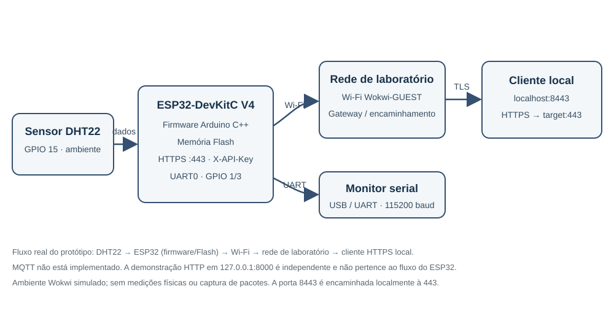

# Avaliação de segurança IoT — NexaSense

## Objetivo e dispositivo

Avaliar, em laboratório autorizado, um protótipo com ESP32-DevKitC V4 e sensor DHT22, cobrindo arquitetura, firmware, interfaces observáveis, protocolos, riscos e medidas para uma futura versão comercial.

## Escopo e limites

- Ambiente: atividade realizada a distância (EAD) com projeto Wokwi; o equipamento físico não foi fornecido, portanto não houve placa para inspeção ou testes físicos.
- Testes restritos ao código/configuração do projeto, simulação e servidor HTTP local em `127.0.0.1`.
- Não foram feitos testes em terceiros, redes de produção, extração física de firmware, captura do tráfego do ESP32, programação irreversível de eFuses ou implantação comercial.
- As constatações distinguem o fonte original arquivado das correções presentes em `src/main.cpp`.
- Nenhuma credencial de produção é fornecida. Não publique arquivos locais de segredo, certificados, chaves, capturas não redigidas nem binários de laboratório.

## Arquitetura e superfície de ataque

O fluxo implementado é DHT22 → ESP32 (firmware e Flash) → Wi-Fi/rede de laboratório Wokwi → encaminhamento local (`localhost:8443` → `target:443`) → cliente HTTPS. UART0 fornece diagnóstico serial. O protótipo não usa MQTT. JTAG, SPI, I²C e pinos de programação foram mapeados a partir da documentação da placa/configuração, não testados em hardware físico.

Detalhes: [architecture/architecture.md](architecture/architecture.md) e [hardware/interface-map.md](hardware/interface-map.md).

## Ferramentas utilizadas

- **Visual Studio Code**, com as extensões PlatformIO IDE e Wokwi Simulator.
- **PlatformIO** e framework Arduino-ESP32 para compilar o firmware.
- **Wokwi** para simular o ESP32 e o DHT22 e executar os cenários controlados.
- **Python 3** e a biblioteca `cryptography` para gerar o certificado de laboratório; scripts Python para testar a API HTTPS encaminhada localmente e demonstrar HTTP independente em loopback.
- Não foram utilizados instrumentos de bancada ou ferramentas de análise física, pois não havia placa disponível.

## Resumo técnico

- **Firmware:** fonte original preservado; hash SHA-256 e limitações em [firmware/hashes.txt](firmware/hashes.txt) e [firmware/analysis-notes.md](firmware/analysis-notes.md). O hash se refere ao fonte, não a um dump original de flash.
- **Hardware:** GPIO 15/DHT22, UART0 e funções alternativas JTAG analisadas por configuração/documentação. Sem inspeção ou medição de placa física.
- **Comunicações:** fonte original usava HTTP/80 e não autenticava a API. A versão de laboratório usa HTTPS/443; os cenários 401/401/200, JSON, rota raiz e 404 foram testados de ponta a ponta pelo encaminhamento Wokwi local, com TLS 1.2. O certificado é autoassinado de teste; isso não é configuração de produção. MQTT não é implementado; a demonstração HTTP local é independente do ESP32.
- **Falha do sensor:** com o DHT22 intencionalmente desconectado no diagrama, a API autenticada retornou HTTP 500 e `{"erro":"Falha na leitura do sensor"}`; a fiação original foi restaurada após o ensaio. É um teste controlado de tratamento de erro, não uma vulnerabilidade.
- **Achados:** [findings/findings.md](findings/findings.md) e [findings/risk-assessment.md](findings/risk-assessment.md).
- **Hardening:** [remediation/hardening-plan.md](remediation/hardening-plan.md).
- **Caso real:** CVE-2019-15894 (ESP-IDF/ESP32, desvio de Secure Boot por injeção física de falha em versões antigas), com fonte NVD e limitações registradas no relatório.

## Principais achados e recomendações

Os achados descrevem condições do fonte original e riscos residuais; as correções mencionadas são da versão de laboratório e não devem ser interpretadas como validação para produção.

- **F-01 — API sem autenticação:** o fonte original permitia acesso sem credenciais. A versão de laboratório exige `X-API-Key` e teve respostas 401/401/200 verificadas; para produção, substituir a chave estática por identidade e autorização individual por dispositivo, com rotação e revogação.
- **F-02 — HTTP sem TLS:** o fonte original transmitia dados sem criptografia. A versão de laboratório usa HTTPS com certificado de teste; em produção, validar confiança TLS e proteger/provisionar chaves por dispositivo.
- **F-04 — espera Wi-Fi sem limite:** o fonte original podia aguardar indefinidamente. A versão de laboratório limita a espera a 10 segundos, mas ainda precisa de reconexão com backoff.
- **F-05 — credenciais recuperáveis do firmware:** chaves necessárias ao serviço ficam incorporadas à imagem. Não distribuir binários ou segredos de laboratório; projetar provisionamento individual e armazenamento protegido.
- **Recomendações adicionais:** avaliar Secure Boot e Flash Encryption com procedimento de fabricação e recuperação; implementar atualização OTA assinada com proteção contra downgrade; controlar JTAG/modos de download em produção; usar WPA2/WPA3; revisar a margem de flash antes de adicionar funcionalidades.

O detalhamento, a priorização e os riscos residuais estão em [findings/findings.md](findings/findings.md), [findings/risk-assessment.md](findings/risk-assessment.md) e [remediation/hardening-plan.md](remediation/hardening-plan.md).

## Evidências

- [Autenticação no Wokwi](network/evidence/F-01-autenticacao.png) — valor de teste redigido.
- [Teste HTTPS no Wokwi](network/evidence/F-01-wokwi-https.png) — saída serial após as requisições integradas.
- [Resultados HTTP](network/evidence/F-01-wokwi-https-test.txt) — confirmações 401/401/200, JSON, rota raiz e rota inexistente.
- [Teste de falha do DHT22](network/evidence/F-06-dht-desconectado-test.txt) e [captura serial](network/evidence/F-06-dht-desconectado-vscode.png) — HTTP 500/JSON de erro após desconexão intencional no Wokwi.
- [Timeout Wi-Fi testado no Wokwi pelo VS Code](network/evidence/F-04-wifi-timeout-vscode.png), [timeout anterior](network/evidence/F-04-wifi-timeout.png) e [conexão normal](network/evidence/F-04-wifi-conexao-normal.png).
- [Demonstração HTTP local](network/evidence/http-python-demo.png) — experimento independente em loopback, não captura do ESP32.
- [Mapa de interfaces](hardware/interface-map.md) — sem evidência física, pois não houve placa.

## Relatório e vídeo

- Relatório técnico: [report/relatorio-tecnico.pdf](report/relatorio-tecnico.pdf) e fonte editável [report/relatorio-tecnico.md](report/relatorio-tecnico.md).
- O vídeo solicitado (máximo de 4 minutos) precisa ser gravado por uma pessoa no ambiente Wokwi/hardware autorizado. [report/video-script.md](report/video-script.md) traz um roteiro e lista de cenas; nenhum vídeo ou link foi criado nesta avaliação.

## Preparação local e compilação

Para instruções detalhadas de instalação das extensões, configuração e execução, consulte o [guia Como executar](COMO-EXECUTAR.md).

O firmware compilado pelo PlatformIO está em `src/main.cpp`. O fonte educacional original, preservado para comparação, está em `firmware/original/nexasense-original.ino`; ele não é o firmware de laboratório atualizado.

Os seguintes arquivos são locais e não devem ser incluídos em repositório, relatório, captura ou pacote público: `src/secrets.h`, `src/certificates.h`, `certificates/server-key.der`, `certificates/server-cert.der` e os binários gerados. O `.gitignore` os exclui.

1. Instale o PlatformIO e as dependências listadas em `platformio.ini`.
2. Copie `src/secrets.example.h` para `src/secrets.h` e substitua o placeholder por uma chave aleatória de laboratório. Não reutilize essa chave em outro dispositivo.
3. Execute `python certificates/generate_certificate.py` para gerar o certificado/chave de teste e `src/certificates.h`. A biblioteca Python `cryptography` é necessária.
4. Compile com `pio run`; execute a simulação com **Wokwi: Start Simulator** no VS Code.
5. Para verificar o timeout, use temporariamente um SSID inexistente, recompile e inicie a simulação; depois restaure `Wokwi-GUEST` e recompile.
6. Com o simulador em execução e o encaminhamento local ativo, execute `python network/test_api_https.py` para verificar autorização e rotas via HTTPS local.
7. Para demonstrar apenas HTTP sem TLS em loopback, execute `python network/teste_http.py`.

Não publique o binário de laboratório: a chave de API e a chave TLS necessárias ao firmware são incorporadas à imagem. Para distribuição, projete provisionamento e armazenamento de identidade por dispositivo.

## Reprodução dos cenários de autenticação

Com a simulação ativa no VS Code e o encaminhamento local disponível (`wokwi.toml`, `localhost:8443` para `target:443`), execute `python network/test_api_https.py`. O teste de integração feito neste projeto confirmou:

- sem `X-API-Key`: esperado HTTP 401;
- chave incorreta: esperado HTTP 401;
- chave local correta: esperado HTTP 200 quando o sensor produzir uma leitura válida.
- com a chave correta e o DHT22 desconectado no diagrama: esperado HTTP 500 com JSON de erro; depois do ensaio, restaure as conexões e reinicie a simulação.

No teste de loopback, a validação convencional de cadeia de confiança e hostname é desabilitada, mas o script compara o certificado DER recebido com a cópia local esperada e rejeita qualquer certificado diferente. Essa comparação exata é pinning de laboratório, não validação de cadeia comercial. O teste fixa TLS 1.2 para compatibilidade com o simulador. Nunca desative validação em produção nem exponha o endpoint à Internet.

## Referências

- [OWASP IoT Security Testing Guide](https://owasp.org/www-project-iot-security-testing-guide/)
- [NISTIR 8259A](https://csrc.nist.gov/pubs/ir/8259/a/final)
- [ETSI EN 303 645 V3.1.3](https://www.etsi.org/deliver/etsi_en/303600_303699/303645/03.01.03_60/en_303645v030103p.pdf)
- [MITRE EMB3D](https://emb3d.mitre.org/)
- [Espressif ESP-IDF Security Overview](https://docs.espressif.com/projects/esp-idf/en/stable/esp32/security/security.html)
