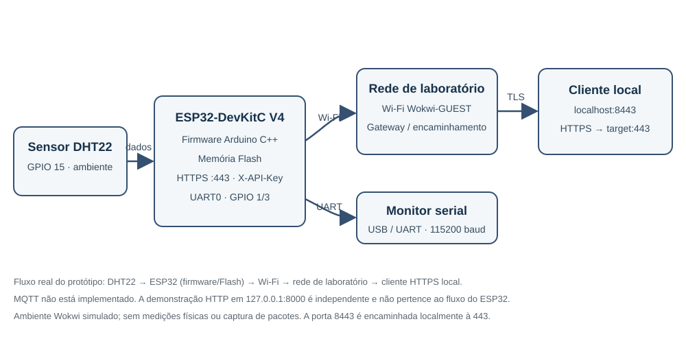

# Arquitetura do NexaSense IoT

## 1. Descrição do dispositivo

O NexaSense é um protótipo IoT de laboratório, simulado no Wokwi, composto por um ESP32-DevKitC V4 e sensor DHT22 para coleta de temperatura e umidade.

O firmware atual usa Wi-Fi para disponibilizar os dados através de um servidor HTTPS. A API simulada pode ser alcançada por um encaminhamento local do Wokwi (`localhost:8443` para `target:443`). O firmware original arquivado usava HTTP sem autenticação; a cópia de trabalho atual adiciona TLS e autenticação por API Key.

## 2. Componentes identificados

| Componente | Descrição |
|---|---|
| ESP32-DevKitC V4 | Modelo de placa selecionado no Wokwi, responsável pelo processamento |
| DHT22 | Sensor de temperatura e umidade |
| Wi-Fi | Comunicação sem fio |
| Servidor HTTPS | Disponibilização dos dados coletados na porta 443 |
| Firmware Arduino C++ | Código responsável pelo funcionamento do dispositivo |

A identificação da placa foi baseada no componente `board-esp32-devkit-c-v4` presente no arquivo `diagram.json`. A variante exata do módulo ESP32 não foi identificada.

## 3. Fluxo efetivamente implementado

```text
DHT22
  │ sinal digital no GPIO 15
  ▼
ESP32 ── Firmware Arduino C++ + memória Flash
  ├── UART0 (GPIO 1/3) ── monitor serial do Wokwi, 115200 baud
  └── Wi-Fi Wokwi-GUEST
        ▼
      Rede/gateway de laboratório do Wokwi
        ▼
      Encaminhamento local: localhost:8443 → target:443
        ▼
      Cliente de teste HTTPS (GET /api/sensor, X-API-Key)
```

O dispositivo atua como **servidor HTTPS**: é o cliente local que envia GET para o ESP32 simulado. O Wokwi fornece a rede/gateway virtual; a conexão feita pelo teste automatizado permanece no computador por meio do encaminhamento local. MQTT não está configurado nem implementado. A demonstração em `network/teste_http.py` usa outro servidor em loopback (`127.0.0.1:8000`) e é independente do caminho de comunicação do ESP32.

## 6. Identificação da placa e memória

A simulação utiliza a placa ESP32-DevKitC V4, identificada no arquivo `diagram.json` pelo componente `board-esp32-devkit-c-v4`.

O microcontrolador pertence à família ESP32, com arquitetura Xtensa de 32 bits, dois núcleos e conectividade Wi-Fi e Bluetooth.

Conforme a documentação do Wokwi, os valores padrão da simulação são:
- Flash: 4 MB.
- PSRAM: 4 MB.

Esses valores representam as configurações padrão do ambiente de simulação, não uma inspeção ou medição de hardware físico.

A variante exata do módulo ESP32 não foi identificada.

## 7. Interfaces de comunicação e depuração

Foram identificadas as seguintes interfaces:

- UART0: utiliza GPIO 1 (TX) e GPIO 3 (RX), conectados ao monitor serial do Wokwi.
- JTAG: utiliza funções alternativas dos GPIOs 12, 13, 14 e 15.
- SPI: interface disponível para comunicação com periféricos, mas não utilizada pelo firmware atual.
- I²C: interface disponível para comunicação com sensores e outros dispositivos, mas não utilizada pelo firmware atual.

O GPIO 15 possui função alternativa MTDO, relacionada ao JTAG, e também participa da configuração de inicialização (*strapping*) do ESP32. No projeto, esse pino está conectado ao sensor DHT22.

A utilização de funções alternativas nos mesmos pinos deve ser considerada durante a análise de hardware e depuração.

## 9. Mapeamento de GPIOs

O ESP32 utilizado na simulação disponibiliza diferentes GPIOs, que podem assumir funções de entrada, saída e comunicação.

Foram identificadas as seguintes categorias:

- GPIOs de comunicação serial: GPIO 1 e GPIO 3.
- GPIOs associados ao JTAG: GPIO 12, GPIO 13, GPIO 14 e GPIO 15.
- GPIOs utilizados frequentemente em configurações SPI: GPIO 18, GPIO 19 e GPIO 23, entre outros.
- GPIOs utilizados frequentemente para I²C: GPIO 21 e GPIO 22.
- GPIOs de entrada somente: GPIO 34, GPIO 35, GPIO 36 e GPIO 39.
- GPIOs associados à memória Flash: GPIO 6, GPIO 7, GPIO 8, GPIO 9, GPIO 10 e GPIO 11.

O GPIO 15 é utilizado pelo sensor DHT22 para transmissão de dados. Esse pino também possui função alternativa MTDO, relacionada à interface JTAG, e participa da configuração de inicialização do ESP32.

## 10. Diagrama simplificado



O diagrama representa a configuração de laboratório descrita pelo firmware e pelo arquivo `diagram.json`. Não representa uma inspeção de placa física.

## 11. Interfaces e aspectos de segurança

A arquitetura apresenta interfaces que merecem atenção durante uma avaliação de segurança:

- UART: pode disponibilizar informações de inicialização e depuração.
- JTAG: pode permitir acesso a recursos internos de depuração.
- SPI: interface disponível, mas não utilizada pelo firmware atual.
- I²C: interface disponível, mas não utilizada pelo firmware atual.
- Wi-Fi: permite a comunicação sem fio do dispositivo.
- HTTPS/TLS: protege o transporte na versão atual de laboratório, usando um certificado autoassinado de teste.
- API Key: exigida pela rota `/api/sensor`; o segredo é fornecido por configuração local não versionada.

A existência dessas interfaces não representa automaticamente uma vulnerabilidade. O risco depende de sua exposição, configuração e dos mecanismos de proteção existentes.

## 12. Limitações da identificação e da análise

O mapeamento foi realizado com base no modelo ESP32-DevKitC V4 selecionado no Wokwi e na documentação técnica da Espressif.

Não foram realizados testes físicos nas interfaces, medições elétricas, inspeções de circuitos reais ou identificação física da variante do módulo ESP32.

As informações de hardware foram obtidas a partir da configuração da simulação e da documentação técnica dos fabricantes.

As características de memória apresentadas correspondem aos valores padrão documentados pelo Wokwi, não a medições de hardware físico.