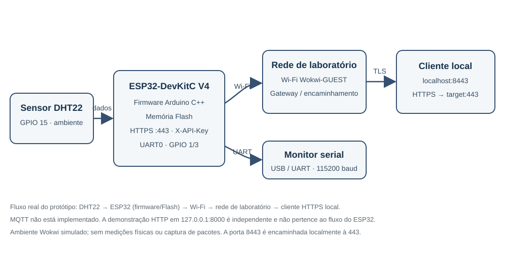

# Do Protótipo ao Produto Seguro
## Avaliação de segurança do dispositivo IoT NexaSense

**Data:** 2 de novembro de 2026  
**Ambiente:** ESP32-DevKitC V4 e DHT22 no simulador Wokwi  
**Escopo:** avaliação educacional controlada; sem testes contra terceiros

## 1. Resumo executivo

O NexaSense é um protótipo ESP32 que mede temperatura e umidade e apresenta os valores por uma API. A análise do firmware original identificou uma rota HTTP sem autenticação, comunicação sem TLS e espera Wi-Fi sem timeout. A versão de laboratório atual adiciona verificação de `X-API-Key`, HTTPS e limite de 10 segundos para conexão inicial. O projeto compilou com sucesso no PlatformIO.

As correções reduzem os riscos demonstrados, mas não tornam a configuração adequada à produção: o certificado é autoassinado, o firmware precisa conter a chave do servidor e a chave de API continua recuperável da imagem. O timeout não implementa reconexão. Os testes de integração foram feitos no ESP32 simulado pelo Wokwi dentro do VS Code; não houve placa física, captura de pacotes, extração de flash ou validação de rede comercial.

## 2. Dispositivo e arquitetura

O projeto simulado contém ESP32-DevKitC V4, DHT22 ligado ao GPIO 15, Wi-Fi `Wokwi-GUEST` e firmware Arduino C++. UART0 conecta-se ao monitor serial; funções alternativas JTAG e outros pinos foram mapeados documentalmente. O fluxo corresponde ao modelo de laboratório: sensor → ESP32 (firmware e memória Flash) → Wi-Fi/rede virtual Wokwi → encaminhamento local (`localhost:8443` → `target:443`) → cliente HTTPS. A API atual usa HTTPS na porta 443; o firmware original usava HTTP na porta 80. MQTT não está implementado; a demonstração HTTP local é independente do dispositivo.

O diagrama representa a configuração de laboratório, não uma placa inspecionada. Memória Flash/PSRAM indicada na arquitetura corresponde à configuração padrão documentada pelo Wokwi, não a medição de hardware.

## 3. Metodologia e evidência

1. Revisão estática do fonte original, cópia atual, dependências e configuração Wokwi/PlatformIO.
2. Preservação do fonte original sem alterações e registro do SHA-256 em `firmware/hashes.txt`.
3. Mapeamento de interfaces pela configuração Wokwi e documentação do ESP32; sem sondagem elétrica de hardware.
4. Execução do firmware no Wokwi pelo VS Code e teste temporário de SSID inexistente: após o limite de 10 segundos, o monitor serial confirmou a falha controlada de conexão. O SSID normal foi restaurado e recompilado depois do ensaio.
5. Testes via encaminhamento local HTTPS: 401 sem chave, 401 com chave incorreta, 200 com chave válida e JSON conforme, 200 na rota raiz e 404 em rota inexistente. O cliente local precisou fixar TLS 1.2 e aceitar o certificado autoassinado somente neste cenário de loopback.
6. Desconexão intencional do DHT22 no diagrama e reinício da simulação: a rota autenticada retornou HTTP 500 com JSON `{"erro":"Falha na leitura do sensor"}`; as respostas de autenticação e demais rotas permaneceram consistentes. Fiação restaurada após o ensaio. Evidência em `network/evidence/F-06-dht-desconectado-test.txt`.
7. Execução local de `network/teste_http.py`, restrita a `127.0.0.1:8000`; demonstrou JSON legível em HTTP, sem representar tráfego do dispositivo.
8. Compilação do firmware atual com `platformio run`; sucesso. A imagem ocupou 99,4% do limite de aplicação reportado.

O ambiente Wokwi não foi usado para expor o servidor à Internet. Não foram realizados testes em sistemas de terceiros, rede de produção, eFuses, captura de pacotes ou placa física.

## 4. Resultados e riscos

| Achado | Evidência | Impacto | Probabilidade no cenário | Risco | Mitigação / estado |
|---|---|---|---|---|---|
| F-01 — API original sem autenticação | Fonte original sem controle; teste integrado Wokwi confirmou 401/401/200 | Leitura não autorizada de temperatura/umidade | Média se a rota estiver alcançável | Médio | Corrigido no firmware atual com `X-API-Key`; chave embarcada ainda pode ser extraída |
| F-02 — HTTP original sem TLS | `WebServer` na porta 80; demonstração Python local independente | Leitura/alteração de tráfego em rede compartilhada | Média se houver interceptação | Médio | HTTPS/TLS 1.2 validado no Wokwi; certificado autoassinado/chave não são solução de produção |
| F-03 — Wi-Fi aberto | SSID `Wokwi-GUEST`, senha vazia | Contextual, não confirmado no produto | Não aplicável ao simulador | Não classificado | Usar WPA2/WPA3 e provisionamento seguro em produção |
| F-04 — Espera Wi-Fi infinita original | Fonte original e ensaio Wokwi atual com SSID inexistente | API indisponível durante falha de conexão | Alta quando a rede falha | Médio | Timeout de 10 s confirmado no monitor serial; falta reconexão/backoff |
| F-05 — Segredos recuperáveis da imagem | Chave de API e chave TLS necessárias ao firmware; arquivos fonte locais ignorados | Reuso de credenciais e personificação se chave for copiada | Média com acesso à imagem/dispositivo | Médio | Não distribuir segredos/binário de laboratório; identidade por dispositivo e armazenamento protegido |

O detalhamento, as limitações e as referências estão em `findings/findings.md` e `findings/risk-assessment.md`.

O teste de desconexão do DHT22 é um ensaio funcional adicional, não um achado de segurança: a resposta HTTP 500 evita apresentar uma leitura inválida como sucesso e está registrada separadamente da matriz de riscos.

## 5. Interfaces e firmware

UART0 pode expor logs de inicialização e o endereço IP; JTAG e modos UART de download merecem controle físico em produção. SPI e I²C não são usados pelo firmware atual. A existência de um pino/interface não é, isoladamente, uma vulnerabilidade: exposição, proteções e impacto precisam ser avaliados em uma placa autorizada.

O fonte original foi preservado em `firmware/original/nexasense-original.ino`; o hash em `firmware/hashes.txt` identifica o arquivo fonte, não uma imagem extraída. Não foi recebida imagem binária original, dump de flash ou sistema de arquivos para engenharia reversa. O código analisado não implementa OTA.

## 6. Caso real e referências

O NVD registra CVE-2019-15894 em versões antigas do ESP-IDF/ESP32: injeção física de falha podia contornar a verificação de Secure Boot e iniciar código não verificado. O registro recomenda proteção em camadas, incluindo Flash Encryption junto a Secure Boot. O caso não comprova que este protótipo seja afetado; as versões vulneráveis listadas são antigas. A lição para a NexaHome é proteger boot, armazenamento e acesso físico como controles complementares.

Referências primárias:

1. [NVD — CVE-2019-15894](https://nvd.nist.gov/vuln/detail/CVE-2019-15894).
2. [OWASP — IoT Security Testing Guide](https://owasp.org/www-project-iot-security-testing-guide/).
3. [NISTIR 8259A — IoT Device Cybersecurity Capability Core Baseline](https://csrc.nist.gov/pubs/ir/8259/a/final).
4. [ETSI EN 303 645 V3.1.3](https://www.etsi.org/deliver/etsi_en/303600_303699/303645/03.01.03_60/en_303645v030103p.pdf).
5. [MITRE EMB3D](https://emb3d.mitre.org/).
6. [Espressif — ESP-IDF Security Overview](https://docs.espressif.com/projects/esp-idf/en/stable/esp32/security/security.html).

As referências fundamentam a metodologia, capacidades esperadas, ameaças embarcadas e mitigação; não são evidência de vulnerabilidade neste protótipo.

## 7. Plano de hardening

1. Emitir identidade, certificado e credencial únicos por dispositivo; estabelecer confiança verificável no cliente, rotação e revogação. Não incorporar chaves compartilhadas ou reutilizáveis.
2. Avaliar Secure Boot e Flash Encryption em configuração de produção, com gestão de chaves e testes de recuperação. Não programar eFuses irreversivelmente sem processo aprovado.
3. Implementar atualização OTA autenticada/assinada, proteção contra downgrade e recuperação; definir processo de suporte e atualização de dependências.
4. Restringir JTAG/UART de download e reduzir logs na produção; planejar manutenção sem expor interfaces privilegiadas.
5. Adicionar reconexão Wi-Fi com backoff e estado seguro; revisar a pequena margem de flash observada no build antes de incluir OTA.

## 8. Conclusão e limitações

O protótipo tem correções funcionais para autenticação da API, proteção do transporte em laboratório e timeout inicial de Wi-Fi. As evidências são adequadas ao ambiente simulado e à demonstração local, mas não substituem teste físico ou captura real do dispositivo. O produto não deve ser implantado comercialmente com a chave de demonstração, certificado autoassinado ou ausência de atualização segura.

O vídeo de demonstração de até quatro minutos ainda precisa ser gravado e publicado; consulte `video-script.md`. Nenhum link de vídeo foi criado.
